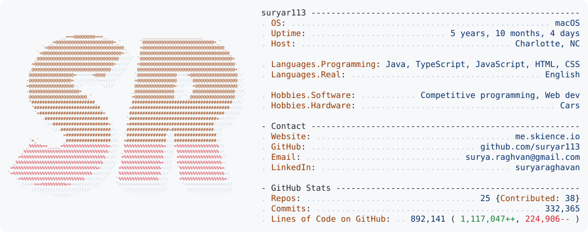

<a href="https://github.com/suryar113/suryar113">
  <picture>
    <source media="(prefers-color-scheme: dark)" srcset="https://raw.githubusercontent.com/suryar113/suryar113/main/dark_mode.svg?v=b42e71b1dd">
    
  </picture>
</a>

<p align="center">
  <a href="https://me.skience.io"></a>
  <a href="https://www.linkedin.com/in/suryaraghavan"></a>
  <a href="mailto:surya.raghvan@gmail.com"></a>
</p>

<p align="center"><sub>Copy my email:</sub></p>

```text
surya.raghvan@gmail.com
```
